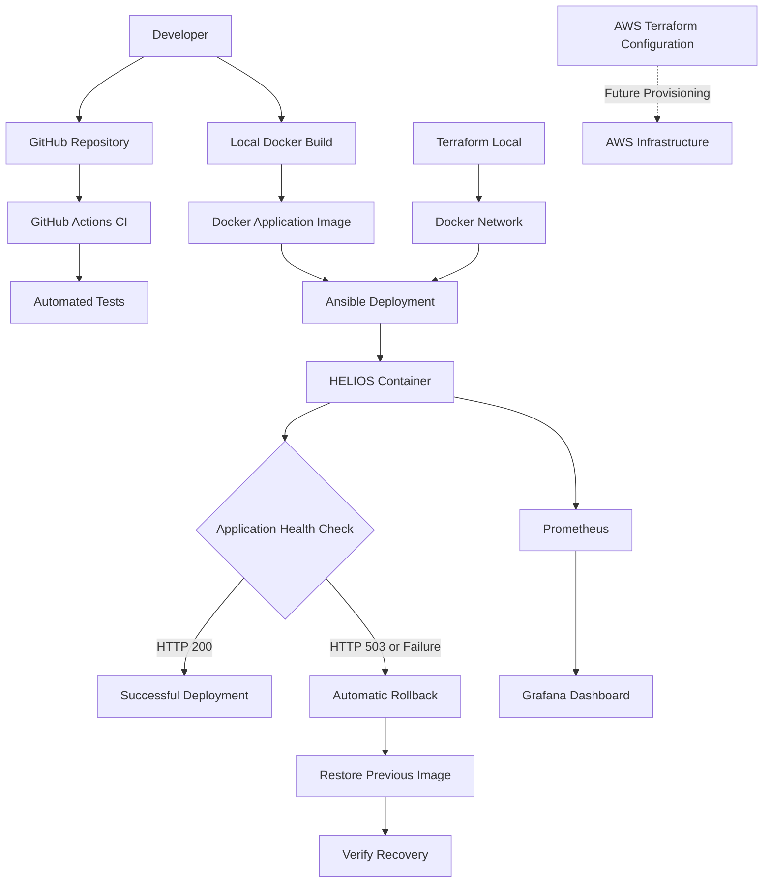

# HELIOS – Automated Cloud Deployment Platform


## Overview

HELIOS is an end-to-end DevOps automation project designed to simplify application containerization, continuous integration, infrastructure management, automated deployment, health monitoring, and deployment failure recovery.

The platform integrates modern DevOps tools to demonstrate a reliable and repeatable application deployment workflow with automated rollback capabilities.

The application, local infrastructure, deployment automation, monitoring, and rollback mechanisms have been implemented and tested locally. Reusable AWS infrastructure configurations are included for future cloud deployment.

## Key Features

- Automated application testing using Pytest.
- Continuous integration using GitHub Actions.
- Docker-based application containerization.
- Infrastructure as Code using Terraform.
- Reusable AWS infrastructure configuration.
- Automated local deployment using Ansible.
- Application health verification.
- Automatic rollback using previous Docker image IDs.
- Deployment failure simulation.
- Real-time application monitoring using Prometheus.
- Grafana dashboard with six monitoring panels.
- HTTP request, success rate, and latency monitoring.

## System Architecture



## Technology Stack

| Technology | Purpose |
|---|---|
| Linux / Ubuntu | Development environment |
| Python 3.12 | Application development |
| Flask | Application REST endpoints |
| Docker | Containerization |
| Git and GitHub | Version control |
| GitHub Actions | Continuous integration |
| Pytest | Automated testing |
| Terraform | Infrastructure as Code |
| AWS | Cloud infrastructure configuration |
| Ansible | Deployment and rollback automation |
| Prometheus | Metrics collection |
| Grafana | Monitoring visualization |

## Project Structure

```text
HELIOS/
├── .github/
│   └── workflows/
│       └── ci.yml
├── app/
│   ├── __init__.py
│   ├── app.py
│   └── requirements.txt
├── ansible/
│   ├── deploy.yml
│   └── inventory.ini
├── monitoring/
│   ├── grafana/
│   │   └── helios-dashboard.json
│   └── prometheus/
│       └── prometheus.yml
├── rollback-test/
│   ├── Dockerfile
│   └── broken_app.py
├── terraform/
│   ├── main.tf
│   ├── providers.tf
│   ├── variables.tf
│   ├── versions.tf
│   └── outputs.tf
├── terraform-local/
│   ├── main.tf
│   ├── providers.tf
│   └── versions.tf
├── tests/
│   ├── test_app.py
│   └── test_metrics.py
├── .dockerignore
├── .gitignore
├── Dockerfile
├── pytest.ini
├── requirements-dev.txt
└── README.md
```

## Application Endpoints

| Endpoint | Description |
|---|---|
| `/` | Application overview |
| `/health` | Application health status |
| `/status` | Application operational status |
| `/system` | System environment information |
| `/metrics` | Prometheus metrics |

## Prerequisites

- Ubuntu Linux or WSL2
- Python 3.12
- Docker Engine or Docker Desktop
- Git
- Terraform
- Ansible

## Installation and Setup

Clone the repository:

```bash
git clone https://github.com/uttam9124/HELIOS.git
cd HELIOS
```

Create a Python virtual environment:

```bash
python3 -m venv .venv
source .venv/bin/activate
```

Install dependencies:

```bash
pip install -r requirements-dev.txt
```

Run automated tests:

```bash
python -m pytest -v
```

## Docker Containerization

Build the application image:

```bash
docker build -t helios-app:v3 .
```

The Docker image includes an application health check for detecting unhealthy containers.

## Local Infrastructure Automation

Terraform manages the local Docker network required by the application and monitoring services.

```bash
terraform -chdir=terraform-local init
terraform -chdir=terraform-local validate
terraform -chdir=terraform-local plan
terraform -chdir=terraform-local apply
```

Review the Terraform plan before confirming the apply operation.

This configuration uses the Docker provider and creates local Docker infrastructure only.

## Automated Deployment

Ansible automates application deployment, container management, health verification, and failure recovery.

Verify the playbook syntax:

```bash
ansible-playbook -i ansible/inventory.ini \
  ansible/deploy.yml --syntax-check
```

Deploy HELIOS:

```bash
ansible-playbook -i ansible/inventory.ini \
  ansible/deploy.yml -e "app_image=helios-app:v3"
```

Verify application health:

```bash
curl -fsS http://localhost:5002/health
```

Expected response includes:

```json
{
  "service": "helios",
  "status": "healthy"
}
```

## Automatic Rollback Mechanism

HELIOS implements a health-check-driven deployment recovery mechanism using Ansible.

The deployment workflow:

1. Records the currently deployed Docker image ID.
2. Deploys the target application image.
3. Performs application health checks.
4. Detects unsuccessful deployment.
5. Removes the failed container.
6. Restores the previous application image.
7. Verifies the recovered application health.
8. Reports the target deployment failure.

### Rollback Failure Simulation

Build an intentionally unhealthy application image:

```bash
docker build --pull=false \
  -t helios-app:broken rollback-test/
```

With a healthy HELIOS deployment running, initiate the failure simulation:

```bash
ansible-playbook -i ansible/inventory.ini \
  ansible/deploy.yml -e "app_image=helios-app:broken"
```

The broken application returns HTTP 503, triggering automatic rollback.

This test temporarily interrupts the managed application.

### Verified Rollback Results

| Validation | Result |
|---|---|
| Broken deployment detection | Passed |
| HTTP 503 detection | Passed |
| Automatic rollback trigger | Passed |
| Failed container removal | Passed |
| Previous image restoration | Passed |
| Application health recovery | Passed |
| Prometheus monitoring recovery | Passed |

The playbook intentionally reports a failed target deployment even when rollback succeeds.

The previous application image was restored successfully, and the recovered health endpoint returned HTTP 200.

## Prometheus Monitoring

Prometheus collects application metrics at five-second intervals.

Start the monitoring server from the project root:

```bash
docker run -d \
  --name helios-prometheus \
  --network helios-network \
  -p 127.0.0.1:9090:9090 \
  -v "$PWD/monitoring/prometheus/prometheus.yml:/etc/prometheus/prometheus.yml:ro" \
  -v helios-prometheus-data:/prometheus \
  --restart unless-stopped \
  prom/prometheus:v3.5.0
```

Access Prometheus:

http://localhost:9090

Verify application scrape availability:

```promql
up{job="helios"}
```

A value of `1` indicates successful metric collection.

## Grafana Dashboard

Start Grafana:

```bash
docker run -d \
  --name helios-grafana \
  --network helios-network \
  -p 127.0.0.1:3000:3000 \
  -v helios-grafana-data:/var/lib/grafana \
  --restart unless-stopped \
  grafana/grafana:12.1.0
```

Access Grafana:

http://localhost:3000

Configure a Prometheus data source using:

```text
http://helios-prometheus:9090
```

Import the dashboard:

```text
monitoring/grafana/helios-dashboard.json
```

Select the configured Prometheus data source during the import.

### Dashboard Panels

- Application Status
- Total Requests
- Success Rate
- HTTP Request Rate
- Average Latency
- Requests by Endpoint

The dashboard visualizes application metrics and monitoring recovery following a failed deployment.

## Continuous Integration

GitHub Actions automatically executes application tests on pushes and pull requests targeting the main branch.

The CI workflow includes:

- Repository checkout.
- Python environment setup.
- Dependency installation.
- Automated application testing.
- Prometheus metrics testing.

Local deployment is performed separately using Ansible.

## Automated Testing Results

Seven automated tests were successfully executed.

| Test | Result |
|---|---|
| Home endpoint | Passed |
| Health endpoint | Passed |
| Status endpoint | Passed |
| System endpoint | Passed |
| Metrics endpoint | Passed |
| HTTP request counter | Passed |
| HTTP request duration | Passed |

```text
7 passed in 0.39s
```

- Total tests: 7
- Passed: 7
- Failed: 0
- Test pass rate: 100%

## AWS Infrastructure Configuration

Reusable Terraform configurations are included for future AWS deployment.

The infrastructure design includes:

- Virtual Private Cloud (VPC).
- Public subnet.
- Internet Gateway.
- Route table.
- Security group.
- EC2 instance.
- SSH key pair configuration.
- IAM role and instance profile.
- Encrypted EBS storage.
- ECR image-pull permissions.

The AWS configuration has been prepared and validated. Cloud infrastructure provisioning was not performed as part of the final local implementation.

AWS resources may incur charges if provisioned.

## Project Outcomes

- Implemented repeatable containerized application deployment.
- Automated application testing through continuous integration.
- Implemented Infrastructure as Code for local infrastructure.
- Developed reusable AWS infrastructure configurations.
- Successfully simulated deployment failure using an unhealthy Docker image.
- Verified automatic recovery using the previous Docker image ID.
- Integrated application monitoring and visualization.
- Verified seven automated tests with a 100% pass rate.

## Scope and Limitations

- Application deployment and rollback were validated in a local Docker environment.
- AWS infrastructure is configuration-only and has not been provisioned.
- Rollback involves temporary application downtime.
- Application metrics counters reset when the application container is recreated.
- Grafana dashboard import requires manual data source configuration.
- GitHub Actions provides CI; local deployment is handled separately by Ansible.
- The Flask development server is intended for demonstration purposes.

## Future Enhancements

- AWS deployment integration.
- Automated continuous delivery.
- Blue-green deployment strategy.
- Kubernetes-based orchestration.
- Automated monitoring alerts.
- Grafana dashboard provisioning.
- Production-grade application server.

## Author

Uttam Kumar Behera

DevOps Enthusiast | Cloud Computing | Infrastructure Automation | Containerization

GitHub: https://github.com/uttam9124

---

**HELIOS – Automate. Deploy. Monitor. Recover.**
